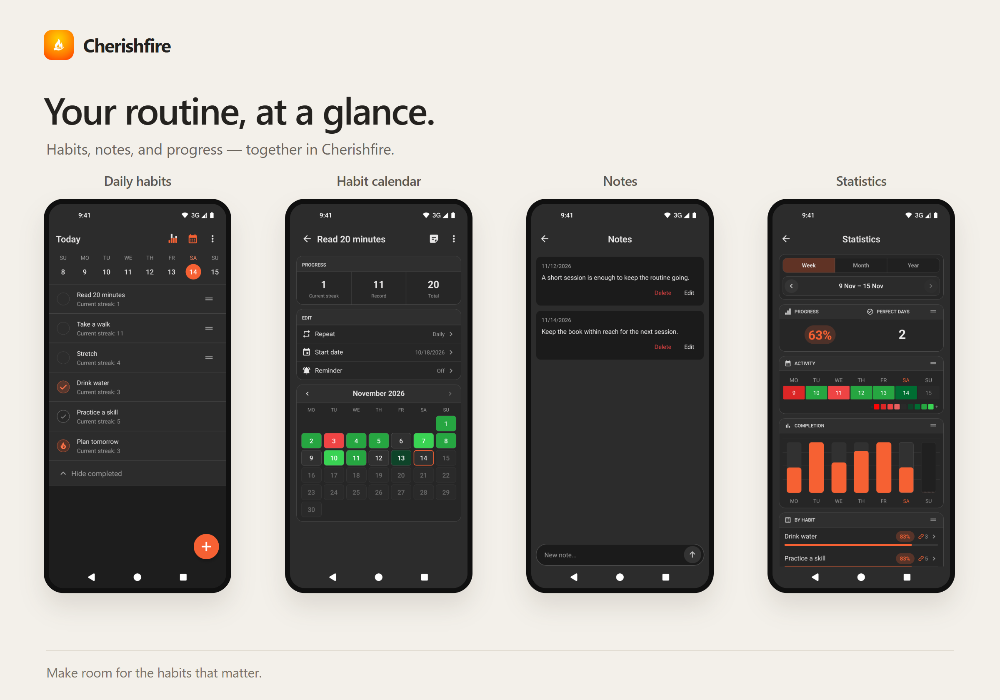

https://github.com/user-attachments/assets/c8818f02-9554-45f5-9ecc-86f4110e60ba

# Cherishfire


An offline habit tracker with flexible schedules, notes, and progress statistics.

[Download APK](https://github.com/YanGranat/Cherishfire/releases/download/v1.5.125/Cherishfire-1.5.125-android.apk)

## Features

- Schedule habits daily, on selected days of the week or dates of the month,
  or at fixed or completion-based intervals.
- Record Done, Minimum, Maximum, Failure, or Skipped outcomes, with optional
  reasons for failures and skips.
- Browse each habit's calendar, current and best streaks, and dated notes.
- Set multiple local reminder times for each habit.
- Review weekly, monthly, and yearly statistics, with a separate block order
  for each period.
- Archive and restore habits without deleting their history.
- Export and restore habits, history, notes, and preferences as JSON.
- Choose light, dark, or system appearance and customize accent colors.

## Preview


https://github.com/user-attachments/assets/2cd2120b-cfca-4136-8ae4-d0d9d95885d3


## Stack

TypeScript, Expo, and React Native, with Expo Router for navigation, Zustand for
shared state, and NativeWind for styling. Reanimated and React Native Gesture
Handler handle animations and drag gestures. Data is stored locally with Expo
SQLite; Drizzle defines the schema and manages migrations.

## Architecture

Routes and screen composition live in `app/`, with feature components and hooks
in `src/features/`. Domain rules and application services are separated from
SQLite repositories and native adapters, wired through `src/composition/`.

## Development

Requires Node.js 22.13.0 or later. Use a supported LTS release.

```sh
npm ci
npm start
```

For a local native build, install the Android or iOS toolchain and run
`npm run android` or `npm run ios`. iOS builds require macOS and Xcode.

EAS Android release builds use [local signing credentials](https://docs.expo.dev/app-signing/local-credentials/).

## Checks

```sh
npm run check
```

## Privacy

See [Privacy Policy](PRIVACY.md).

## License

The application source code is available under [MIT](LICENSE). Third-party
components and icon fonts retain their respective licenses; see
[third-party notices](assets/third_party_notices.json).
